# Run Monitor

A training-run monitor for machine-learning experiments. It shows the run list and the **loss**, **learning rate** and **gradient norm** charts of every run, and is built to answer one question: _can someone trust these charts when deciding whether to stop a $500 run?_

Made for the Soup internship take-home task (Frontend Engineer). The main idea: a chart that **looks** right and a chart that **is** truthful are not the same thing. The app never hides a spike, never draws NaN as 0, never connects a line across missing data, and the tests prove it.

- **Deploy:** https://albinous.github.io/run-monitor/
- **Write-up:** [NOTE.md](NOTE.md) — truthfulness, performance, silent failures, verdict
- **Tests:** 46 tests, output in [test-output.txt](test-output.txt)

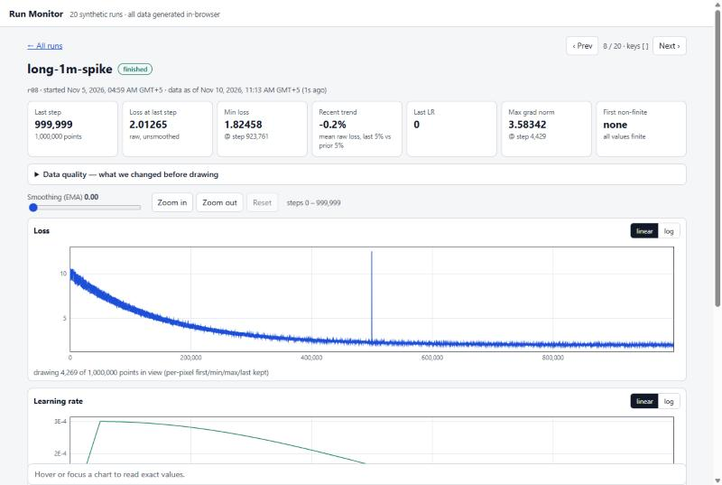

---

## Tech stack

| Area     | Tools                                                  |
| -------- | ------------------------------------------------------ |
| Language | TypeScript (strict mode)                               |
| UI       | React 18                                               |
| Charts   | Canvas 2D, own renderer (no chart library)             |
| Styles   | Plain CSS, CSS custom properties, light and dark theme |
| Tests    | Vitest                                                 |
| Bundler  | Vite                                                   |
| Deploy   | GitHub Pages (GitHub Actions)                          |

No chart library on purpose: to prove the chart is truthful, every step from raw data to pixels has to be our own code that we can test.

---

## Getting started

```bash
git clone https://github.com/Albinous/run-monitor.git
cd run-monitor
npm install
npm run dev
```

| Script                           | What it does                                     |
| -------------------------------- | ------------------------------------------------ |
| `npm run dev`                    | Start the dev server                             |
| `npm run build`                  | Type-check and build to `dist/`                  |
| `npm run preview`                | Preview the production build                     |
| `npm test`                       | Run all 46 tests                                 |
| `npx vite-node scripts/bench.ts` | Compare "draw every point" with M4 on the 1M run |

### URL flags

| Flag             | What it does                                                    |
| ---------------- | --------------------------------------------------------------- |
| `?perf=1`        | Shows compute and draw time per chart and the JS heap size      |
| `?render=naive`  | Draws every raw point (the "before" version for the comparison) |
| `?locale=de-DE`  | Formats numbers and dates for another locale                    |
| `?tz=Asia/Tokyo` | Shows dates in another time zone                                |

---

## How to use

1. Open the **run list**. Sort by any column, filter by name, id or defect (`nan`, `gaps`…) and by status.
2. Open a run. At the top you see the **summary cards**. They are always computed from raw data, never from the smoothed line.
3. Open **Data quality** to see what was changed before drawing: sorted steps, removed duplicates, gaps, NaN and ±∞ counts.
4. Explore the charts. All three charts share one zoom and one cursor. Hover a chart to read exact raw values.
5. Turn on **Smoothing** if the line is noisy. The raw line stays visible underneath, and a warning reminds you that smoothing lags.
6. Switch a chart to the **log** scale. Values `≤ 0` can't be drawn on a log axis, so they are shown as ▼ markers and counted.

### Controls

| Action              | Mouse / touch                 | Keyboard (chart in focus) |
| ------------------- | ----------------------------- | ------------------------- |
| Move the cursor     | Hover the chart               | `←` / `→`                 |
| Zoom in / out       | Mouse wheel, **Zoom** buttons | `+` / `-`                 |
| Pan                 | Drag the chart                | `Shift` + `←` / `→`       |
| Reset zoom          | Double click, **Reset**       | `0` or `Esc`              |
| Previous / next run | **‹ Prev** / **Next ›**       | `[` / `]`                 |

- Every chart can be focused with `Tab`. The values under the cursor are announced in an `aria-live` area for screen readers.
- Sort headers and scale switches are real `<button>`s, so `Tab`, `Enter` and `Space` work everywhere.

---

## Implemented features

### 1. Build it

- [x] **Run list**
  - sorting by any column, `aria-sort` on headers;
  - empty values and NaN always go last;
  - filter by text and status.
- [x] **Run page**
  - loss, lr and grad_norm charts with a shared zoom and cursor;
  - summary cards and the data-quality panel.
- [x] **States**: loading, empty run (`r10`), error with Retry (`r11`), stale data (`r12`), "no runs match".
- [x] **Responsive layout**: no horizontal scroll at 375 px; less important columns are hidden on phones.
- [x] **Keyboard control**: see [Controls](#controls).
- [x] **Contrast**: text at least 4.5:1 in both themes, visible focus outline.

### 2. Truthful chart

- [x] **Spike visible at every zoom level**: M4 downsampling keeps the min and max of every pixel column.
- [x] **NaN is never drawn as 0 or smoothed**: the line breaks and a red marker is drawn; smoothing restarts after NaN.
- [x] **Duplicates and unsorted steps** are fixed before drawing (sort by step, last write wins).
- [x] **Numbers and axis labels match the data**: tested label by label.

### 3. Performance

- [x] 1M points: 1,000,000 → about 3,200 points sent to the canvas.
- [x] The cursor is drawn on a separate canvas, so hover never recalculates the chart.
- [x] Numbers before and after: see [Performance](#performance).

### 4. Silent failures

- [x] Request race when switching runs quickly.
- [x] Stale data from a failed refresh.
- [x] Locale and time zone.
- [x] Smoothing that hides divergence.
- [x] Log scale with zeros.

### 5. Verdict

- [x] **DON'T SHIP yet**, with the list of what to change first — see [NOTE.md](NOTE.md#5-verdict-dont-ship-yet-for-a-500-stopcontinue-decision).

---

## Test runs

All 20 runs are generated in the browser with a seeded random generator, so every visit shows the same data.

| Run         | Name                     | What is broken                                           |
| ----------- | ------------------------ | -------------------------------------------------------- |
| `r01`       | baseline-125m            | nothing (lr starts and ends at exactly 0)                |
| `r02`       | baseline-350m (slow API) | the API answers in 2.5 s, good for testing request races |
| `r03`       | nan-loss-sporadic        | 5 NaN values in loss                                     |
| `r04`       | diverged-lr-3e-3         | loss grows, then `+∞`, then NaN until the end            |
| `r05`       | resume-duplicates        | 1,000 duplicate steps after a resume from checkpoint     |
| `r06`       | unsorted-logs            | steps arrive out of order                                |
| `r07`       | logging-gaps             | two gaps in the logs                                     |
| `r08`       | long-1m-spike            | 1,000,000 points, one spike at step 500,000              |
| `r09`       | inf-and-nan-mixed        | `+∞`, `−∞` and NaN                                       |
| `r10`       | empty-run                | no points yet                                            |
| `r11`       | broken-endpoint          | the API always returns HTTP 500                          |
| `r12`       | live-run (flaky polling) | grows every second, ~30% of requests fail                |
| `r13`       | late-divergence          | loss explodes in the last 150 steps                      |
| `r14`–`r20` | sweeps and ablations     | nothing — normal runs for comparison                     |

---

## How the chart stays truthful

```
raw logs ─► clean ─► segments ─► M4 per pixel ─► canvas
             │          │             │
             │          │             └─ keeps first, min, max, last of every pixel column
             │          └─ a line never crosses NaN, ±∞, a gap, or ≤ 0 on a log axis
             └─ sort by step, last write wins for duplicates, find gaps, count NaN / ±∞
```

- **Y range** comes from the raw values in view, not from the downsampled or smoothed line. If the spike is in view, the axis reaches it.
- **Instead of fake values** the chart shows markers:

  | Value                      | How it is shown                            |
  | -------------------------- | ------------------------------------------ |
  | NaN                        | Red dashed band over the full chart height |
  | `+∞` / `−∞`                | Red triangle at the top / bottom edge      |
  | `≤ 0` on a log axis        | ▼ at the bottom, counted under the chart   |
  | Logging gap                | The line breaks, no straight segment       |
  | One point between two NaNs | A dot (a 1-point line would be invisible)  |

- **Summary cards** use raw values. "Loss at last step" shows NaN for a diverged run, not the last nice number.

| Spike after zooming in                             | NaN and +∞ in a diverged run                         |
| -------------------------------------------------- | ---------------------------------------------------- |
| 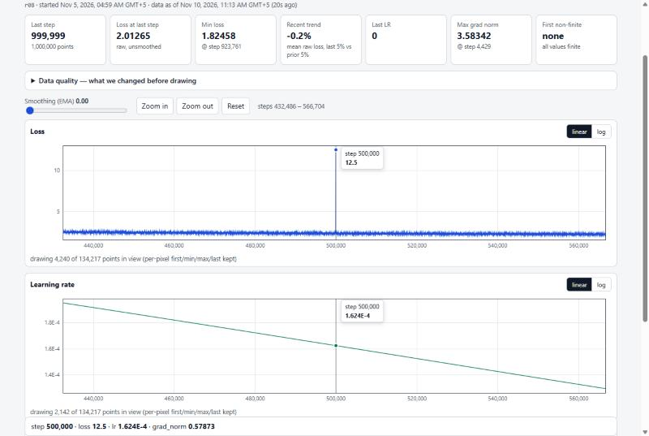 | 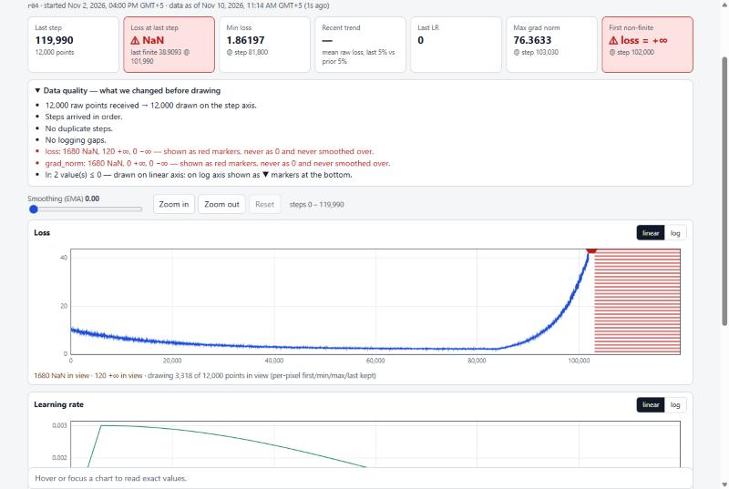 |

| Smoothing hides divergence, the cards don't             | Log scale with zeros                               |
| ------------------------------------------------------- | -------------------------------------------------- |
| 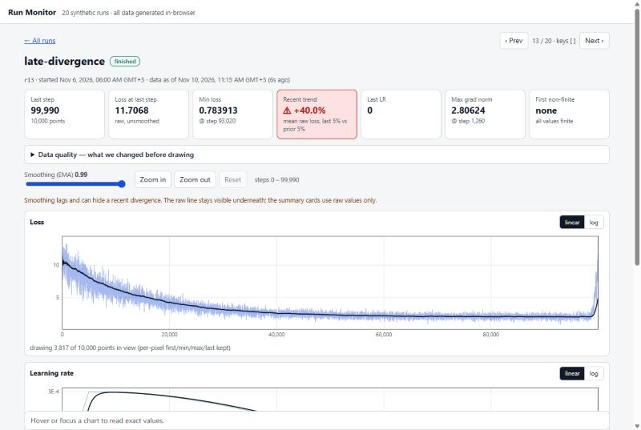 | 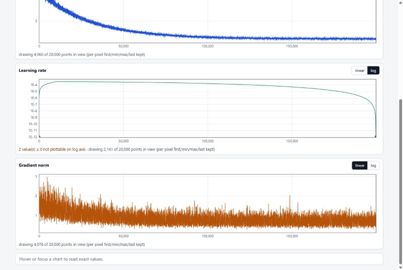 |

---

## Silent failures

| Problem              | What could go wrong                                     | What the app does                                                           |
| -------------------- | ------------------------------------------------------- | --------------------------------------------------------------------------- |
| Request race         | A slow answer for the old run replaces the new run      | The old request is aborted, and late answers are dropped by sequence number |
| Stale data           | A failed refresh leaves old numbers that look current   | "Data as of … (N s ago)" and a yellow **STALE DATA** banner                 |
| Locale               | `1,234` means 1234 in English and 1.234 in German       | Numbers are formatted with `Intl` and never parsed back from text           |
| Time zone            | "08:00" without a zone is ambiguous                     | Every date shows its zone; sorting uses timestamps, not text                |
| Smoothing            | A heavy EMA hides a recent blow-up                      | Off by default, raw line always visible, "Recent trend" card on raw data    |
| Log scale with zeros | `log(0) = −∞` breaks the chart or silently drops points | Zeros become ▼ markers and are counted                                      |

| Stale data                                | Error state                                | Empty run                                  |
| ----------------------------------------- | ------------------------------------------ | ------------------------------------------ |
| 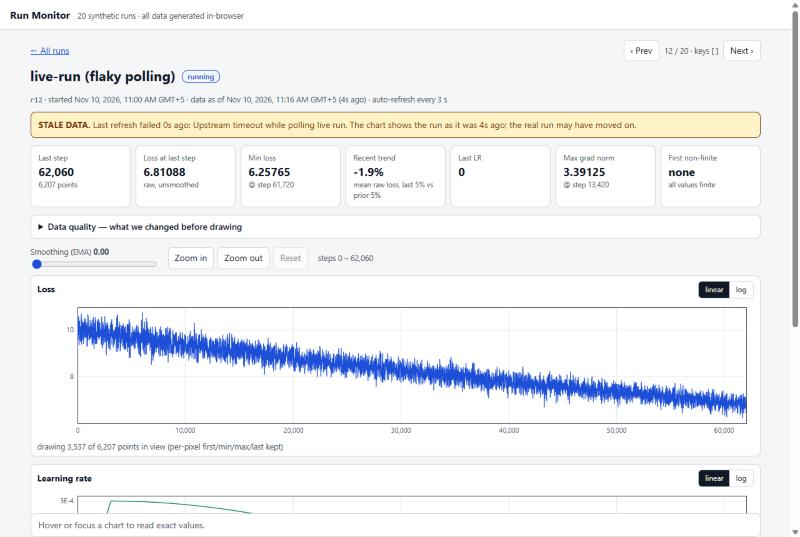 | 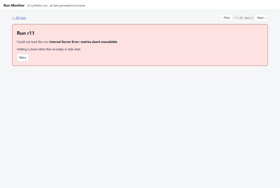 | 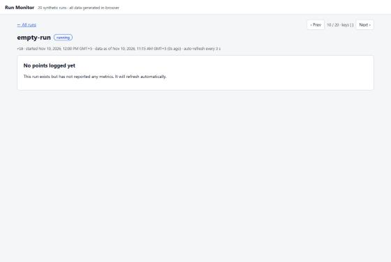 |

---

## Performance

Frame computation on the 1M-point run (`npx vite-node scripts/bench.ts`, Node, median / p90):

| View        | Draw every point | M4           | Points drawn      |
| ----------- | ---------------- | ------------ | ----------------- |
| Full 1M     | 25.7 / 39.8 ms   | 1.7 / 4.6 ms | 1,000,000 → 3,195 |
| 250k window | 4.6 / 11.9 ms    | 0.9 / 1.0 ms | 250,003 → 3,191   |
| 10k window  | 0.2 / 0.3 ms     | 0.4 / 0.7 ms | 10,003 → 2,943    |

- With only 10k points in view M4 is a little slower: there are ~3 points per pixel, so there is nothing to save.
- JS heap at 1M points in Chromium: 77 MB (draw every point) → 48 MB (M4).
- DevTools Performance trace with CPU 4× slowdown: see [NOTE.md](NOTE.md#3-performance-1m-points).

---

## Mobile and dark theme

| Run list                                              | Cards                                                   | Charts                                                    |
| ----------------------------------------------------- | ------------------------------------------------------- | --------------------------------------------------------- |
| 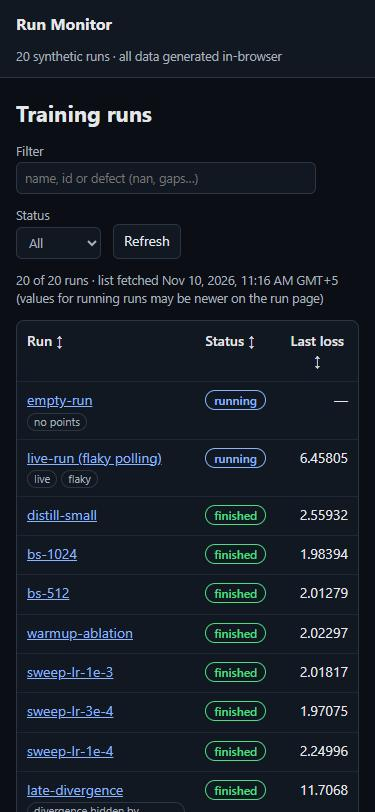 | 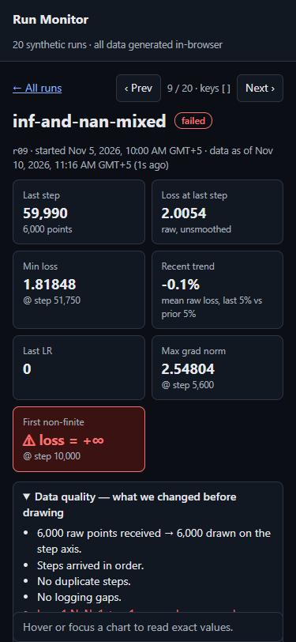 | 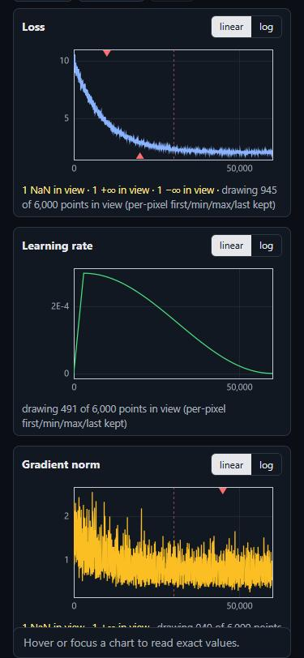 |

---

## Project structure

```
src/
├── core/            pure logic, no React and no DOM
│   ├── types.ts       shared types
│   ├── clean.ts       sort, remove duplicates, find gaps, count NaN / ±∞
│   ├── index.ts       block min/max index, drawable segments, binary search
│   ├── downsample.ts  M4 downsampling, EMA smoothing
│   ├── frame.ts       scales, ticks, lines and markers for one chart
│   ├── draw.ts        canvas renderer
│   ├── summary.ts     numbers for the summary cards
│   ├── latest.ts      request-race guard
│   └── format.ts      numbers and dates with an explicit locale and time zone
├── data/
│   ├── generate.ts    20 runs with defects (seeded)
│   └── api.ts         mock backend: async, abortable, slow, failing, live
├── ui/              React
│   ├── App.tsx        routing: #/ list, #/run/<id> run page
│   ├── RunList.tsx    run list
│   ├── RunPage.tsx    run page, cards, controls
│   ├── Chart.tsx      one interactive chart
│   ├── useRunData.ts  loading, polling, stale detection
│   ├── env.ts         URL flags
│   └── styles.css     themes and layout
└── main.tsx         entry point
tests/               Vitest: truthfulness, silent failures, dataset
scripts/             performance benchmark
docs/screenshots/    screenshots for README and pull requests
```

### Architecture

```
api.getRun(id) → cleanRun() → prepareMetric() → computeFrame() → drawFrame() → canvas
                  (once)        (once per metric)  (on zoom / resize)  (on change)
```

- **All rules live in `src/core`** as pure functions. They don't know about React or the DOM, so they are easy to test.
- **React only holds the state** (selected run, zoom, cursor, smoothing) and calls the core.
- **The cursor** is drawn on a separate transparent canvas, so moving the mouse doesn't recalculate the chart.
- **Every request** goes through `createLatest()`, so only the answer for the current run can reach the screen.

---

## Git workflow

- `main` — project setup and releases
- `develop` — integration branch
- `feature/*`, `chore/*` — one branch per feature, merged into `develop` through pull requests
- Final pull request `develop` → `main`
- Commit messages follow [Conventional Commits](https://www.conventionalcommits.org/)

---

## Author

[Albinous](https://github.com/Albinous)
